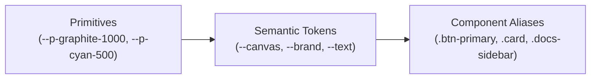
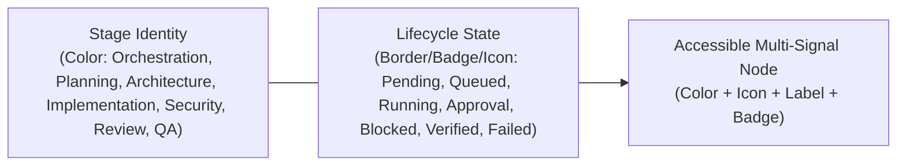

# Axym Design System Specification — Arctic Graphite

**Design Direction:** AXYM ARCTIC GRAPHITE — Precision. Intelligence. Autonomy.  
**Version:** 1.0.0  
**Implementation:** `site/assets/styles.css`  

---

## 1. Design Token Architecture

The Axym Design System employs a strict three-tier token hierarchy to ensure visual discipline, dark/light parity, and prevent raw hard-coded values from appearing in component declarations:

1. **Primitive Tokens (`--p-*`):** Raw color and geometric scales defined in `:root`. Never consumed directly by UI components.
2. **Semantic Tokens (`--canvas`, `--surface`, `--text`, `--brand`, etc.):** Abstracted roles bound to theme selectors (`html[data-theme="dark"]`, `html[data-theme="light"]`).
3. **Component Aliases:** Scoped variables consuming semantic tokens for specific components (e.g. `--btn-primary-bg: var(--brand)`).



---

## 2. Color Palettes & Distribution

Visual real-estate distribution strictly enforces:
- **60–70%**: Neutral graphite or frost surfaces (calm foundation).
- **20–25%**: Secondary and elevated surfaces (structural elevation).
- **5–10%**: Glacial cyan / deep teal brand accents (focused signal).
- **Residual**: Reserved semantic states (success, warning, error, info).

### 2.1 Dark Theme — Arctic Graphite (Default)

| Token | CSS Variable | Hex Value | Role & Usage |
|---|---|---|---|
| Canvas | `--canvas` | `#080F15` | Default page background |
| Canvas Alt | `--canvas-alt` | `#0D1820` | Secondary backdrops, header blur base |
| Surface | `--surface` | `#101E27` | Standard component cards, panels |
| Elevated Surface | `--surface-elevated`| `#14232C` | Raised cards, active menu items |
| Overlay Surface | `--surface-overlay` | `#1B2D38` | Modals, dialogs, dropdowns |
| Surface Inset | `--surface-inset` | `#0A131A` | Terminal shells, code backgrounds |
| Primary Text | `--text` | `#EDF8FA` | Primary headings and high-contrast copy |
| Secondary Text | `--text-secondary` | `#A0B7C2` | Body text, descriptions, table cells |
| Muted Text | `--text-muted` | `#849CA9` | Captions, timestamps, disabled labels |
| Primary Brand | `--brand` | `#5DE4DF` | Glacial cyan action buttons, active states |
| Brand Hover | `--brand-hover` | `#91F2EE` | Glacial cyan hover state |
| Brand Pressed | `--brand-pressed` | `#42C8C3` | Glacial cyan active/pressed state |
| Secondary Brand | `--brand-secondary`| `#348BBD` | Secondary accents, architecture nodes |
| Text on Brand | `--on-brand` | `#080F15` | Deep graphite text on cyan elements |
| Subtle Border | `--border-subtle` | `#253641` | Card dividers, subtle container edges |
| Standard Border | `--border` | `#3C5260` | Default card boundaries, inputs |
| Interactive Border | `--border-interactive`| `#567383`| Hovered inputs, focused boundaries |
| Success | `--success` | `#65DDA5` | Passing tests, active verified status |
| Warning | `--warning` | `#F4C477` | Approvals required, experimental tags |
| Danger / Error | `--danger` | `#FF8495` | Security blocks, failed steps |
| Information | `--info` | `#7DBBFA` | Architecture notes, plan stages |
| Focus Indicator | `--focus` | `#5DE4DF` | 2px high-visibility focus ring |

### 2.2 Light Theme — Arctic Frost

| Token | CSS Variable | Hex Value | Role & Usage |
|---|---|---|---|
| Canvas | `--canvas` | `#F5F8FA` | Clean light page background |
| Canvas Alt | `--canvas-alt` | `#EAF0F4` | Subdued section backdrops |
| Surface | `--surface` | `#FFFFFF` | Pure white cards and panels |
| Elevated Surface | `--surface-elevated`| `#E0E9EF` | Raised controls, hover states |
| Overlay Surface | `--surface-overlay` | `#FFFFFF` | Modal dialogs, popup menus |
| Surface Inset | `--surface-inset` | `#EAF0F4` | Inset terminal backgrounds |
| Primary Text | `--text` | `#10232D` | High-contrast dark charcoal headings |
| Secondary Text | `--text-secondary` | `#48616E` | Slate body copy and descriptions |
| Muted Text | `--text-muted` | `#586F7C` | Subdued metadata and helper copy |
| Primary Brand | `--brand` | `#006E73` | Deep Arctic teal action buttons |
| Brand Hover | `--brand-hover` | `#00585D` | Deep teal hover state |
| Brand Pressed | `--brand-pressed` | `#00494D` | Deep teal pressed state |
| Secondary Brand | `--brand-secondary`| `#23658F` | Supporting brand elements |
| Text on Brand | `--on-brand` | `#FFFFFF` | Crisp white text on primary teal buttons |
| Subtle Border | `--border-subtle` | `#D4E0E6` | Subtle dividers and table borders |
| Standard Border | `--border` | `#BACDD6` | Standard card and container borders |
| Interactive Border | `--border-interactive`| `#718A98`| Focused form controls |
| Success | `--success` | `#08784E` | Passing badges, verified status |
| Warning | `--warning` | `#8A5000` | High-contrast warning indicators |
| Danger / Error | `--danger` | `#B42340` | Error banners and danger alerts |
| Information | `--info` | `#205FA8` | Informational callouts and tips |
| Focus Indicator | `--focus` | `#006E73` | 2px high-contrast teal focus ring |

---

## 3. Engineering Graph Visual Language

Axym's execution graph uses an explicit, 2-dimensional taxonomy that permanently separates **Pipeline Stage Identity** from **Execution Lifecycle Status**. A node's role remains visually identifiable while its execution state transitions independently.



### 3.1 Stage Identity Palette

| Stage | Dark Theme Token | Light Theme Token | Semantic Role |
|---|---|---|---|
| **Orchestration** | `#5DE4DF` | `#006E73` | Root run supervisor & task dispatch |
| **Planning** | `#7DBBFA` | `#205FA8` | Objective decomposition & dependency resolution |
| **Architecture** | `#A8B8FF` | `#4657B0` | System design & boundary contracts |
| **Implementation**| `#5DE4DF` | `#006E73` | Agent code generation & workspace edits |
| **Security** | `#F4C477` | `#8A5000` | Secret scanning & policy compliance |
| **Code Review** | `#C6B3F5` | `#7545A8` | Static analysis & diff inspection |
| **Quality Assurance**| `#65DDA5` | `#08784E` | Integration test execution & verification |
| **Governance** | `#A0B7C2` | `#48616E` | Constitutional guardrails & permission gates |
| **Failure Node** | `#FF8495` | `#B42340` | Blocked runs & unrecoverable errors |

### 3.2 Lifecycle State Communication

No state is conveyed by color alone. Every node renders:
1. Stage color pip.
2. Textual node label.
3. Explicit status badge (`Running`, `Awaiting approval`, `Verified`, `Failed`).
4. Distinct SVG status icon or spinner.

---

## 4. Typography & Geometry

### 4.1 Typeface Selection
- **Primary Interface:** Self-hosted `Geist` variable WOFF2 font with fallback to system UI (`Inter`, `-apple-system`, `BlinkMacSystemFont`, `Segoe UI`, `Roboto`).
- **Technical & Code:** Self-hosted `JetBrains Mono` variable WOFF2 font with tabular numerals (`tnum`) for version strings, SHA-256 hashes, terminal sessions, and tables.

### 4.2 Scale
- **Hero Heading:** `clamp(2.5rem, 1.5rem + 4.4vw, 5.25rem)` (64–84px on desktop)
- **Section Heading:** `clamp(1.875rem, 1.4rem + 2vw, 2.75rem)` (32–44px)
- **Subsection Heading:** `1.5rem` (24px)
- **Component Heading:** `1.125rem`–`1.25rem` (18–20px)
- **Body Text:** `1rem` (16px) with 1.6 line height
- **Documentation Body:** `1.0625rem` (17px) constrained to `50rem` (`800px`)
- **Metadata / Badges:** `0.75rem`–`0.8125rem` (12–13px)

### 4.3 Spacing & Geometry Scale
- Spacing: 4px base (`4px`, `8px`, `12px`, `16px`, `24px`, `32px`, `48px`, `64px`, `96px`, `128px`).
- Radius:
  - Small controls / tags: `4px` (`--radius-xs`)
  - Buttons and inputs: `8px` (`--radius-md`)
  - Standard cards: `12px` (`--radius-lg`)
  - Feature containers: `16px` (`--radius-xl`)
  - Product showcase frames: `20px` (`--radius-2xl`)
  - Pills: `999px` (`--radius-pill`) — reserved for compact status tags only.

### 4.4 Brand Mark & Geometric Monogram
The official Axym brand mark replaces the legacy generic "Z" path with a precision-engineered geometric monogram fusing **A** (apex architecture, autonomous build) and **X** (cross-agent verification nexus, execution coordinates).

```svg
<svg xmlns="http://www.w3.org/2000/svg" viewBox="0 0 64 64">
  <rect width="64" height="64" rx="14" fill="var(--brand)"/>
  <path d="M17 38L32 15L47 38M17 26L32 49L47 26" fill="none" stroke="var(--on-brand)" stroke-width="5.5" stroke-linecap="round" stroke-linejoin="round"/>
</svg>
```

- **Dual Interlocking Chevrons:** Upper chevron (`M17 38L32 15L47 38`) creates the A apex pointing upward; lower chevron (`M17 26L32 49L47 26`) intersects the waist forming the X nexus with bilateral and 180° rotational symmetry.
- **Negative Space Core:** Forms an Arctic Diamond / Hexagon at the center coordinate, symbolizing local-first cryptographic governance and verifiable SQLite event ledgers.
- **Rendering Disciplines:** Clean vector scaling across 16px favicon, 24px header navigation, 64px component cards, and 180px mobile touch icons.

